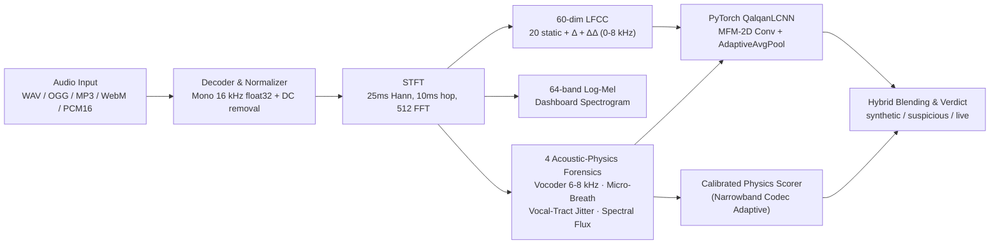

# QALQAN Voice — System Architecture

## 1. Design Principle: Physics of Sound Over Transcript Semantics

Western voice anti-spoofing tools are predominantly trained on clean English corpora and often degrade on:
- **Kazakh phonetics** (uvular/velar stops, vowel harmony, front-rounded vowels)
- **Russian / Kazakh bilingual code-switching** (*шала-қазақша*, mixed phrases within one utterance)
- **Compressed channels** (WhatsApp Opus, Telegram `.ogg`, GSM / SIP telephony)

QALQAN Voice inspects **language-agnostic acoustic physics** paired with a compact neural classifier so detection works across Kazakh, Russian, and mixed speech while staying fast enough for real-time call monitoring (< 2s window, < 50ms CPU inference per chunk).

## 2. Signal Processing & Feature Pipeline (`qalqan/audio/`)

### Acoustic-Physics Indicators
1. **`hf_vocoder_score` (6–8 kHz Vocoder Band):** Evaluates spectral ripple, Wiener entropy (spectral flatness), and temporal coefficient of variation in 6–8 kHz. Neural vocoders (HiFi-GAN, BigVGAN, ElevenLabs, RVC) frequently leave subtle high-frequency upsampling periodicity or unnatural stationarity compared to organic fricative bursts.
2. **`breath_pause_score` (Micro-Breath & Pause Cadence):** Measures inter-phrase noise floor (dead digital silence vs. ambient floor), pre-onset inhalation/aspiration energy (1.5–5 kHz in the 180 ms window preceding speech onsets), and pause-duration entropy.
3. **`resonance_smoothness_score` (Vocal-Tract & Pitch Jitter):** Estimates voiced $F_0$ cycle-to-cycle relative jitter via parabolic autocorrelation peak interpolation combined with cepstral delta variance.
4. **`phase_stationarity_score` (Spectral Flux Uniformity):** Tracks L2 spectral flux variability across voiced frames.
5. **Narrowband Codec Awareness (`codec_narrowband`):** When telephony or aggressive WhatsApp compression strips frequencies above ~3.8 kHz, the detector automatically down-weights the 6–8 kHz band and shifts weight toward breath dynamics, pitch micro-perturbation, and mid-band artifacts.

## 3. Neural Architecture (`qalqan/ml/model.py`)

`QalqanLCNN` implements a **Light Convolutional Neural Network (LCNN)** with **Max-Feature-Map (`MFM2d` / `MFM1d`)** activations—an architecture established across ASVspoof benchmarks for compact, high-efficiency spoofing detection:

- **Input 1:** `(B, 1, 60, T)` utterance-normalized (CMVN) LFCC tensor (arbitrary duration `T` supported via `AdaptiveAvgPool2d((4, 4))`).
- **Input 2:** `(B, 4)` LayerNorm-normalized acoustic-physics forensic vector fused before the classification head.
- **Footprint:** Lightweight CPU inference suited for **air-gapped / on-premise** deployment without GPU dependency; exportable to ONNX via `scripts/export_onnx.py`.

## 4. Interfaces & Deployment Modes

| Surface | Entry Point | Purpose |
|---|---|---|
| **Web Dashboard** | `GET /` | Live spectrogram monitor, microphone WebSocket capture (`M`), drag-drop file analysis, RU/KZ/EN switching, one-click demo simulation |
| **REST API** | `POST /api/v1/analyze` | Synchronous file verification for banking antifraud, call-center gateways, and backend integrations |
| **Streaming WS** | `WS /ws/stream` | Rolling 3.5s sliding-window verification of 16 kHz PCM16 streams (~0.65s hop) |
| **Telegram Bot** | `python -m qalqan.bot.telegram_bot` | Instant verification of forwarded voice notes (`.ogg`), audio files, and video notes for citizens & security teams |
| **On-Premise / Air-Gapped** | `Dockerfile` / `docker-compose.yml` | Self-contained container with FFmpeg + CPU PyTorch — zero outbound data transfer |
